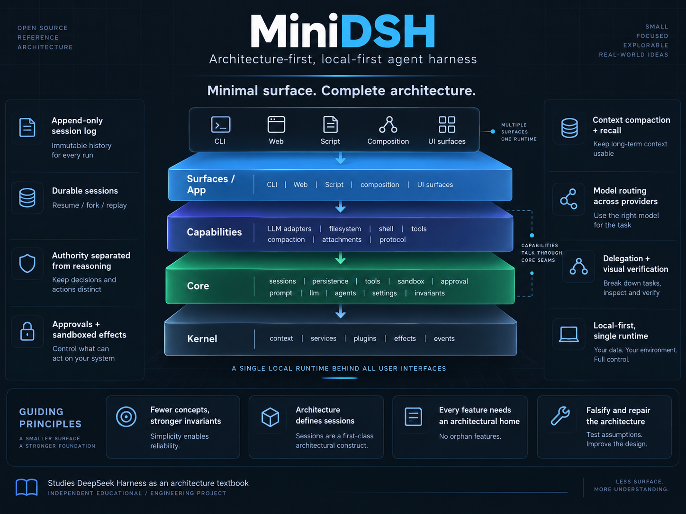
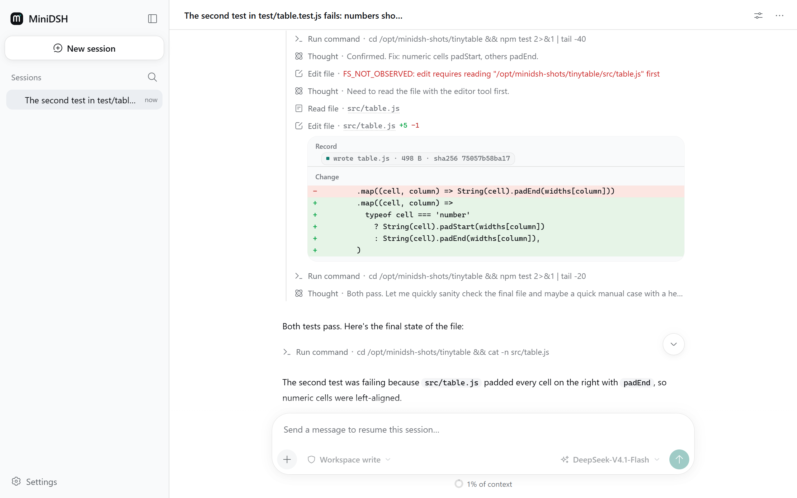
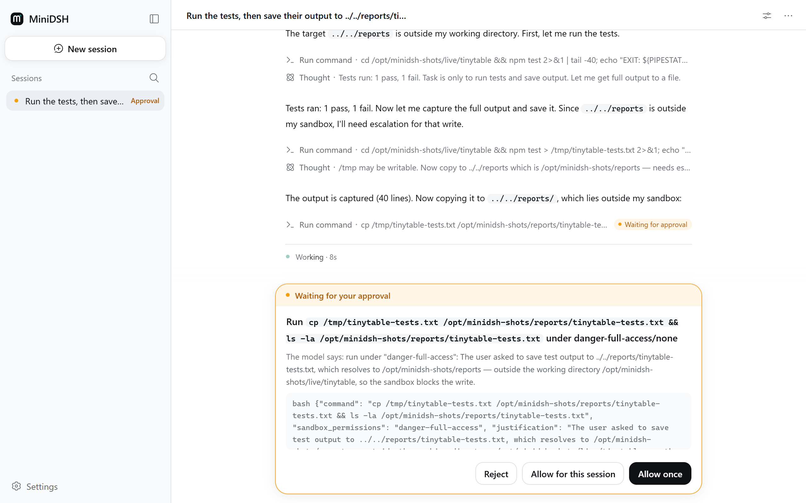
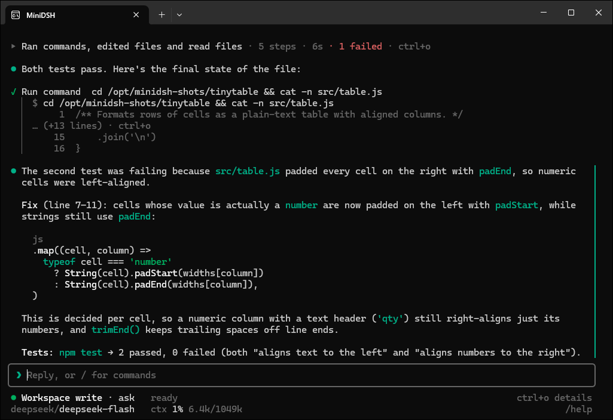
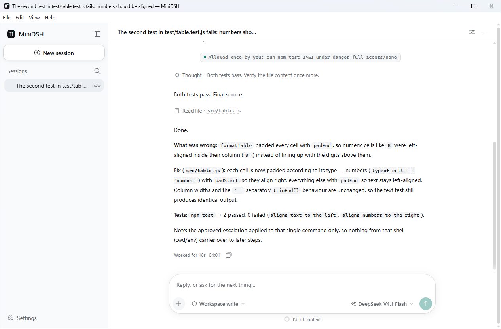

# MiniDSH

[](https://www.npmjs.com/package/minidsh)
[](https://github.com/earthwalker17/MiniDSH/actions/workflows/check.yml)
[](LICENSE)




MiniDSH is a small coding-agent harness that runs on your own machine: the program around a language model that gives it tools, sessions and permissions. It studies [DeepSeek Harness](https://github.com/deepseek-ai/deepseek-harness) (DSH) as a textbook and is written independently of it. It is an experiment and a learning resource first, and it does not compete with DSH or with any product.

## What MiniDSH is

- **Software you can use.** A coding agent for a terminal, a browser, a desktop window or a script. It edits files and runs commands in one project folder, under permissions you set.
- **An architecture small enough to read whole.** Four layers in one package, with a rule about which layer may import which. The [code tour](src/README.md) follows one turn through it.
- **An experiment in method.** Coding-agent sessions wrote nearly all of the code against an architecture that was written down first. The [case study](docs/CASE-STUDY.md) reports what held and what did not.

## Quick start

You need:

- **Node 24 or later**, and a provider key: `DEEPSEEK_API_KEY` (the default), `ANTHROPIC_API_KEY` or `OPENAI_API_KEY`.
- **Windows:** PowerShell 7 (`pwsh`). Shell commands cannot be confined there, so by default none runs until you approve it ([details](#status-and-limitations)).
- **Linux:** `bubblewrap`, so the kernel can confine shell commands. Without it Linux behaves like Windows. **macOS:** nothing extra.

```sh
npm install -g minidsh
minidsh credentials set DEEPSEEK_API_KEY   # asks for the key and stores it

minidsh chat                 # the terminal, in the current folder
minidsh web                  # the browser UI: open the link it prints
minidsh sessions list        # what is stored
minidsh resume <id>          # continue a stored session

# One task from a script. --approve answers yes to every permission request.
minidsh run "fix the failing test" --approve
# Another provider: name the model too.
minidsh chat --provider anthropic --model claude-sonnet-5
```

**Desktop app.** Download it for [Windows x64](https://github.com/earthwalker17/MiniDSH/releases/latest/download/MiniDSH-Setup-x64.exe), [Linux x64 (AppImage)](https://github.com/earthwalker17/MiniDSH/releases/latest/download/MiniDSH-x86_64.AppImage), [macOS Apple silicon](https://github.com/earthwalker17/MiniDSH/releases/latest/download/MiniDSH-mac-arm64.zip) or [macOS Intel](https://github.com/earthwalker17/MiniDSH/releases/latest/download/MiniDSH-mac-x64.zip). The builds are unsigned, so Windows and macOS may warn or block on first run. The guide covers [the first run](docs/GUIDE.md#desktop-app) and how to [verify a download](docs/GUIDE.md#verify-a-download).

The [guide](docs/GUIDE.md) has the rest: keys and models, approvals, sessions, configuration and troubleshooting.

## What you get

<p align="center"></p>

One real turn in the web UI. The first edit was refused because the model had not read the file. It read the file, and the edit went through as the diff shown. The guide shows [the dark theme](docs/GUIDE.md#web).

- **Sessions that outlive their process.** A session is one append-only log under `~/.minidsh/sessions`. Kill the process mid-turn and `minidsh resume` repairs the log and continues. `minidsh fork` branches a session at an earlier turn.
- **Permissions you set, and a record of them.** By default writes stay inside the project folder. A shell command that needs more must ask, and the ask shows the exact command. `minidsh sessions show <id> --audit` prints what was allowed and what each call did.

<p align="center"></p>

- **Three providers.** DeepSeek, Anthropic and OpenAI. A session can change model partway through.
- **Long conversations are summarised.** When history nears the model's window, or the provider refuses a request as too large, the oldest part is replaced by a summary. The originals stay in the log. The model can read them back, and nothing makes it do so.
- **Delegation.** The model can hand a bounded task to a child agent whose permissions cannot exceed its parent's. Several children can run at once.
- **Background jobs.** A dev server or a slow test run keeps going while the agent works. Its end is reported to the session.
- **A browser tool.** Where Chrome, Edge or Chromium is installed, the agent can open a local page, read it, click and take a screenshot. By default it reaches only localhost and the project's files. Web search is a separate tool, off until you add it.
- **Skills.** A folder with a `SKILL.md` teaches the agent a kind of task. Two ship, for Office documents and PDFs ([skills/README.md](skills/README.md)).
- **Four ways in.** The terminal, the web UI, the desktop app and the headless `run` use one runtime and the same stored sessions. `minidsh serve` speaks the terminal's and the web UI's [JSON-RPC protocol](src/capabilities/protocol/README.md) on stdio, for a client of your own.

<p align="center"> </p>

## Status and limitations

**Version 2.0.0.** MiniDSH is one person's project. The [changelog](CHANGELOG.md) lists what each release changed. The limits you are likely to meet first:

- **Windows has no shell confinement.** A shell command there can write wherever your account can, so by default none runs until you approve it. `--accept none` turns that off: shell commands then run unasked and unconfined, and only the editor's writes stay inside the project folder. A headless `run` cannot ask, so it refuses and prints which flag would allow the command.
- **The installers are unsigned and do not update themselves.** A new version is a new download.
- **Only the Windows desktop build was used by hand.** The macOS and Linux builds start and pass a test suite that needs no provider key on CI runners. Nobody has run a macOS build by hand, and the Linux app was driven only unpacked, so the AppImage's own launcher was never run. The `minidsh` command is tested on macOS in CI only.
- **The web sign-in cookie is scoped to the host name, not the port.** A browser also sends it to other servers on that name, and one of them could drive a session. The desktop app is not affected.
- **There is no MCP client and no plugin marketplace.**

The full list is [ARCHITECTURE section 13](docs/ARCHITECTURE.md#13-known-limitations-current). [SECURITY.md](SECURITY.md) says where the boundaries are. In short, the sandbox limits where files are written. It does not limit reads or the network.

## The question it investigates

Coding agents add features to a repository quickly. A common result passes its tests while its structure decays: features land where it is convenient, ownership blurs, and each later session has to rediscover why the system looks the way it does.

DSH answers that pressure with a harness composed of plugins on [Cordis](https://github.com/cordiverse/cordis), each with a declared lifecycle. MiniDSH asks what the minimum agent harness is that still keeps the properties needed for composition, observability, verification, several surfaces and long-term maintenance.

The working rule is that everything meant to be replaced has a seam, and a plain helper does not need one. [PROJECT.md](docs/PROJECT.md) has the argument.

## Architecture

```
src/app/           assembly and surfaces: the CLI, the terminal, the web host, configuration
src/capabilities/  one directory per provider, tool or policy. None imports another
src/core/          the contracts and their default drivers: sessions, agents, tools, authority
src/kernel/        contexts, plugins, services and events. Imports nothing above it
```

A script in `pnpm check` fails an import that points the wrong way.

- **The log is the only record.** The model's history and the current permissions are derived from it.
- **What the model sees is what was logged.** Each request is checked against the log before it is sent.
- **Disk before action.** The log is synced before every model call and every tool effect.
- **The model proposes, policy decides, the effect boundary enforces.** A write is checked where it happens.

Start with the [code tour](src/README.md), then the notes for each layer: [kernel](src/kernel/README.md), [core](src/core/README.md), [capabilities](src/capabilities/README.md), [app](src/app/README.md) and the [desktop app](desktop/README.md). [ARCHITECTURE.md](docs/ARCHITECTURE.md) is the contract: what each part owns and where a new thing goes.

## What MiniDSH learned from DeepSeek Harness

DSH is the larger and more capable system: 391 packages by its own module graph on 2026-11-18, with MCP, agent teams and a plugin manager that MiniDSH does not attempt.

**Taken**

- Capabilities are plugins with a declared lifecycle and dependencies.
- The model's history is derived from an append-only session log.
- The wire is newline-delimited JSON-RPC. The bubblewrap profile starts from DSH's.

**Simplified**

- A small kernel in place of Cordis, and one package in place of hundreds.
- Two shell confinement backends. DSH adds Landlock and a Windows one.
- A child agent is a call its parent waits for. DSH's run in the background.

**Different**

- Writes stay in the project folder. DSH also allows temp directories and extra roots.
- A child's permissions are an enforced ceiling. In DSH a later switch replaces them.
- Web search is opt-in and asks per query. DSH mounts search and fetch by default.

The [core](src/core/README.md), [capabilities](src/capabilities/README.md) and [app](src/app/README.md) notes compare module by module. Reasons: [ARCHITECTURE section 12](docs/ARCHITECTURE.md#12-divergences-from-deepseek-harness-the-ones-that-still-shape-decisions). The map of DSH: [references/](references/README.md).

## The architecture-first experiment

The sessions that wrote the code run under a short constitution, [CLAUDE.md](CLAUDE.md). Its first rule is that the architecture defines what a session does, and a session does not redefine the architecture. A capability needs a home in the written architecture before it gets code. After each cluster of changes, a hardening session rereads the whole system and looks for documented claims the code does not keep. Those sessions found real defects, and CI found others they had missed. The [case study](docs/CASE-STUDY.md) is the dated record: what each kind of check found, where the method failed, and what might carry over to another project.

## Verification

`pnpm check` runs the type check, the linter, the import gate, a documentation gate and more than 2,000 tests (2026-11). CI runs it on Ubuntu, macOS and Windows, then installs the packed tarball and starts it. The tests mount the real runtime and script or replay only the model.

Live tests give real tasks to real providers and assert on the outcome: a file changed, a killed process resumed, a page seen in a browser. A release waits for the ones CI holds keys for. The OpenAI and web-search ones are run by hand. See [CONTRIBUTING.md](CONTRIBUTING.md) and [ARCHITECTURE section 10](docs/ARCHITECTURE.md#10-verification).

## Documents and help

- [Guide](docs/GUIDE.md): install, keys, the four surfaces, approvals, sessions, configuration, troubleshooting
- [Case study](docs/CASE-STUDY.md): the method and what it found
- [Code tour](src/README.md): the source in reading order
- [ARCHITECTURE.md](docs/ARCHITECTURE.md): the contract and the known limitations
- [PROJECT.md](docs/PROJECT.md): the thesis
- [BLUEPRINT.md](docs/BLUEPRINT.md): what comes next and the development record
- [SECURITY.md](SECURITY.md), [CONTRIBUTING.md](CONTRIBUTING.md), [CHANGELOG.md](CHANGELOG.md)

Report a bug or ask a design question in the [issue tracker](https://github.com/earthwalker17/MiniDSH/issues). Report a vulnerability privately, as [SECURITY.md](SECURITY.md) describes.

## License and attribution

MIT. See [LICENSE](LICENSE). MiniDSH is an independent project inspired by [DeepSeek Harness](https://github.com/deepseek-ai/deepseek-harness) (MIT, © DeepSeek). It is not affiliated with or endorsed by DeepSeek. The code is written independently. Where a profile, a contract or artwork is adapted from DSH, [NOTICE](NOTICE) says so.
